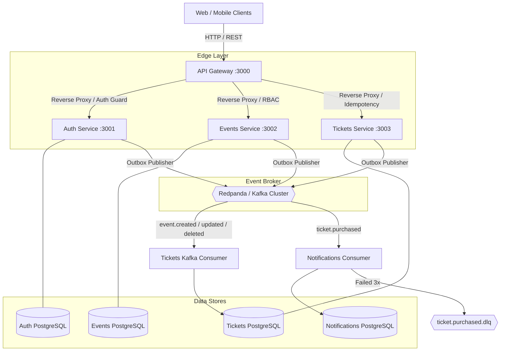
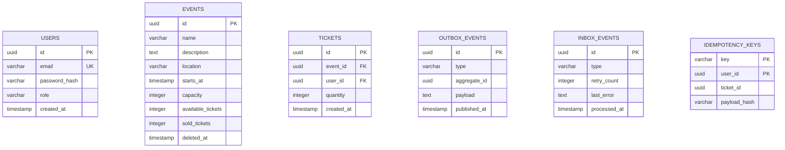

# Even — Event Ticketing Platform

> **An event-driven microservices backend engineered for high-concurrency ticket flash sales, zero-overselling guarantees, and at-least-once message delivery.**

---

## 🌟 Executive Summary

**Even** is an enterprise-grade, distributed event ticketing platform built with **NestJS**, **Apache Kafka (Redpanda)**, **PostgreSQL**, and **Drizzle ORM**. It solves the classic architectural challenges of high-volume ticket flash sales:

1. **Zero-Overselling Guarantee:** Eliminating race conditions at the database engine level when thousands of users attempt to purchase the final remaining tickets at the exact same millisecond.
2. **Dual-Write Consistency:** Implementing the **Transactional Outbox Pattern** to ensure database operations and Kafka message publishing stay perfectly consistent without heavy two-phase commits (2PC).
3. **Fault Tolerance & Retries:** Implementing a **State-Aware Idempotent Inbox** with a **Dead Letter Queue (DLQ)** to guarantee notifications never drop messages during downstream outages without stalling Kafka partitions.
4. **Idempotent API Operations:** Protecting clients against network drops and automatic retries using **RFC 9535-compliant** SHA-256 validated idempotency keys.

---

## 📐 System Architecture

The platform follows a **Database-per-Service** architecture. Client traffic enters synchronously via the **API Gateway**, while asynchronous events stream across microservices boundaries via **Kafka**.



---

## 🛠️ Tech Stack

| Layer | Technology | Rationale |
|---|---|---|
| **Framework** | [NestJS 12](https://nestjs.com/) | Enterprise TypeScript framework with modular dependency injection. |
| **Monorepo Tooling** | [pnpm workspaces](https://pnpm.io/) | Fast, disk-efficient package management and monorepo orchestration. |
| **Database ORM** | [Drizzle ORM](https://orm.drizzle.team/) | Type-safe SQL builder with minimal runtime overhead and schema-first migrations. |
| **Database Engine** | [PostgreSQL 18](https://www.postgresql.org/) | ACID transactions, row-level locks (`FOR UPDATE SKIP LOCKED`), and atomic updates. |
| **Event Streaming** | [Redpanda (Kafka API)](https://redpanda.com/) | Ultra-low latency, C++-powered Kafka alternative without JVM overhead. |
| **Authentication** | [Argon2](https://github.com/ranisalt/node-argon2) + [JWT](https://jwt.io/) | Secure password hashing and stateless token authentication. |
| **Rate Limiting** | [@nestjs/throttler](https://github.com/nestjs/throttler) | Sliding window rate limiter tracking client IPs via proxy headers. |
| **Containerization** | [Docker Compose](https://docs.docker.com/compose/) | Isolated multi-service local environment and reproducible builds. |

---

## ⚡ Core Distributed Systems Patterns

### 1. Atomic Inventory Concurrency (Zero Overselling)
In a high-concurrency ticket flash sale, naive read-modify-write logic (`SELECT capacity` $\rightarrow$ check in JavaScript $\rightarrow$ `UPDATE`) causes lost updates and overselling.
- **Solution:** Pushed capacity verification and subtraction into a single atomic PostgreSQL update statement with predicate pushdown:
```sql
UPDATE events
SET available_tickets = available_tickets - :quantity,
    sold_tickets = sold_tickets + :quantity
WHERE id = :eventId
  AND available_tickets >= :quantity
  AND starts_at > NOW()
  AND deleted_at IS NULL;
```
If available tickets are insufficient or the event was cancelled, zero rows are modified, preventing overselling without blocking locks.

### 2. Transactional Outbox Pattern (Dual-Write Consistency)
Writing to PostgreSQL and publishing to Kafka cannot be executed as a distributed 2PC transaction.
- **Solution:** When an entity changes (e.g., ticket created), the domain event is inserted into an `outbox_events` table in the **exact same ACID database transaction**.
- A background worker (`OutboxPublisher`) periodically polls `outbox_events` using `SELECT ... FOR UPDATE SKIP LOCKED LIMIT 10`.
- It publishes to Kafka using the `aggregateId` as the partition key to guarantee strict sequential message ordering per aggregate.

### 3. State-Aware Idempotent Inbox & Dead Letter Queue (DLQ)
Kafka guarantees at-least-once delivery, which can produce duplicate messages during network rebalances.
- **Solution:** Consumer events are keyed by outbox UUID (`message.id`) in an `inbox_events` table.
- If a message succeeds, it is marked complete. Redeliveries are recognized and ignored.
- If a transient failure occurs (e.g., mail server temporary downtime), the inbox tracks the retry state, permitting Kafka to retry up to 3 times before routing the message to a Dead Letter Queue (`ticket.purchased.dlq`) and committing the offset to prevent queue stalling.

### 4. RFC 9535-Compliant Idempotency Keys
Network hiccups between the client and API Gateway often cause client-side retries.
- **Solution:** Clients supply an `Idempotency-Key` header with purchase requests.
- The server stores `(key, userId, payloadHash)` using SHA-256.
- Retrying with the **same payload** returns the existing ticket without double charging.
- Retrying with a **different payload** is rejected with `409 Conflict` (payload tampering protection).

### 5. Edge-Aware Rate Limiting
- The API Gateway trusts upstream proxies (`trust proxy: 1`) and resolves the real client IP.
- The real client IP is injected into `X-Forwarded-For`.
- Microservices trust the gateway's forwarded IP, ensuring rate limits are calculated **per end-user**, avoiding the classic bug where the entire user base is locked out by sharing the gateway's IP.

---

## 🧩 Microservices Breakdown

| Service | Port | Database | Responsibilities |
|---|:---:|---|---|
| **API Gateway** (`apps/api-gateway`) | `3000` | N/A | Public reverse proxy, JWT validation, RBAC enforcement (`CUSTOMER`, `ORGANIZER`, `ADMIN`), client IP resolution, CORS. |
| **Auth Service** (`apps/auth`) | `3001` | `auth_db` | User registration, Argon2 password hashing, JWT issuance, atomic email uniqueness, user events outbox. |
| **Events Service** (`apps/events`) | `3002` | `events_db` | Event catalog management, concurrency locks (`FOR UPDATE`), ownership validation with Admin override, event lifecycle outbox. |
| **Tickets Service** (`apps/tickets`) | `3003` | `tickets_db` | Atomic inventory reservation, soft-delete safety, local read-replica synchronization from Kafka, idempotency engine. |
| **Notifications Service** (`apps/notifications`) | `3004` | `notifications_db` | Asynchronous email/alert dispatch, state-aware idempotent inbox deduplication, Dead Letter Queue (`.dlq`). |
| **Shared Library** (`libs/shared`) | N/A | N/A | Shared Zod schemas, JWT auth guards, topic constants, TypeScript types. |

### Microservices Deep Dive

#### 1. API Gateway (`apps/api-gateway`) — Port 3000
- **Public Reverse Proxy:** Single entrypoint routing traffic to internal services using Express HTTP proxy.
- **Security & Authorization:** Verifies JWT signatures and validates roles (`@Roles('CUSTOMER', 'ORGANIZER', 'ADMIN')`).
- **Edge IP Resolution:** Configured with `trust proxy: 1` to resolve actual client IPs from load balancers/proxies and injects clean `X-Forwarded-For` and `X-Real-IP` headers to downstream services.
- **CORS & Headers:** Enforces security policies and passes through custom idempotency headers.

#### 2. Auth Service (`apps/auth`) — Port 3001
- **Password Hashing:** Uses `argon2` for modern resistance against GPU-based brute-force attacks.
- **Atomic Registration:** Enforces email uniqueness at the database layer with `INSERT ... ON CONFLICT DO NOTHING`.
- **Transactional Outbox:** Atomically records `user.registered` domain events within the user creation transaction.
- **Edge Rate Limiting:** Enforces `ThrottlerGuard` (3 registrations / 5 logins per minute) based on genuine client IP.

#### 3. Events Service (`apps/events`) — Port 3002
- **Event Lifecycle:** Manages event catalog, dates, descriptions, venues, and ticket capacity.
- **Pessimistic Concurrency:** Protects event updates with `SELECT ... FOR UPDATE` row locks to prevent simultaneous update overwrites.
- **RBAC & Ownership:** Restricts updates to the owning organizer while providing administrators system-wide override access.
- **Event Streaming:** Publishes `event.created`, `event.updated`, and `event.deleted` events through its outbox publisher.

#### 4. Tickets Service (`apps/tickets`) — Port 3003
- **Zero Overselling Engine:** Atomic inventory decrement directly in PostgreSQL (`available_tickets = available_tickets - quantity` where `available_tickets >= quantity`).
- **Soft-Delete Protection:** Ensures tickets cannot be purchased for deleted or cancelled events (`isNull(deletedAt)`).
- **Asynchronous Read Replica:** Consumes Kafka `event.*` topics to maintain synchronized local event records without distributed database joins.
- **Idempotency Engine:** Tracks `(key, userId, payloadHash)` to return cached results on retries and block race conditions.

#### 5. Notifications Service (`apps/notifications`) — Port 3004
- **Async Event Consumer:** Consumes `ticket.purchased` events from Kafka and dispatches notifications.
- **Idempotent Inbox:** Deduplicates messages by message UUID to guarantee at-most-once notification delivery.
- **Dead Letter Queue (DLQ):** Retries transient downstream failures up to 3 times before routing unrecoverable messages to `ticket.purchased.dlq` without blocking the Kafka partition.

#### 6. Shared Library (`libs/shared`)
- **Common Contracts:** Centralized Zod validation schemas, JWT guard decorators, Kafka topic definitions, and TypeScript interfaces across all microservices.

---

## 🗄️ Database Schemas (ER Diagram)



---

## 🚀 Quick Start

### Prerequisites
- [Docker & Docker Compose](https://www.docker.com/)
- [Node.js 22+](https://nodejs.org/)
- [pnpm 9+](https://pnpm.io/)

### 1. Clone & Setup Environment

```bash
git clone https://github.com/ryadevx/event-flow
cd even
cp .env.example .env
pnpm install
```

### 2. Start Full Platform with Docker

```bash
docker compose -f infrastructure/docker-compose.yml --env-file .env up --build
```
This automatically boots:
- **PostgreSQL 18** (initializes `auth_db`, `events_db`, `tickets_db`, `notifications_db`)
- **Redpanda (Kafka)**
- **Migrations Container** (runs Drizzle migrations automatically)
- **All 4 Microservices** + **API Gateway**

---

## 🧪 Automated End-to-End Testing

The repository includes an automated end-to-end smoke test script ([test.sh](test.sh)) that validates the complete flow against a running stack:

```bash
chmod +x test.sh
./test.sh
```

### What `./test.sh` Tests:
1. **Customer Registration & JWT Login**
2. **Organizer Registration & Role Elevation**
3. **Event Creation** by Organizer
4. **Kafka Asynchronous Synchronization** (verifies event propagates from `events_db` to `tickets_db`)
5. **Atomic Ticket Purchase** with `Idempotency-Key`
6. **Idempotent Purchase Verification** (ensures duplicate key returns existing ticket without double charging)
7. **Ticket Ownership Verification** (`findMyTickets`)
8. **Capacity Modification & Soft Deletion**

### Unit & Integration Tests:
```bash
pnpm --filter tickets test
pnpm --filter auth test
pnpm --filter events test
```

---

## 📡 API Reference

All requests route through the **API Gateway** at `http://localhost:3000`.

### Authentication (`/auth`)
| Method | Endpoint | Access | Description |
|---|---|---|---|
| `POST` | `/auth/register` | Public | Register a new user account |
| `POST` | `/auth/login` | Public | Login and obtain JWT bearer token |

### Events (`/events`)
| Method | Endpoint | Access | Description |
|---|---|---|---|
| `GET` | `/events` | Public | List all active events |
| `GET` | `/events/:id` | Public | Get single event details by ID |
| `POST` | `/events` | ORGANIZER, ADMIN | Create a new event |
| `PATCH` | `/events/:id` | ORGANIZER, ADMIN | Update event details & capacity |
| `DELETE` | `/events/:id` | ORGANIZER, ADMIN | Cancel / soft-delete event |

### Tickets (`/tickets`)
| Method | Endpoint | Access | Required Headers | Description |
|---|---|---|---|---|
| `GET` | `/tickets` | CUSTOMER, ADMIN | `Authorization: Bearer <token>` | View current user's purchased tickets |
| `POST` | `/tickets/purchase` | CUSTOMER, ADMIN | `Idempotency-Key: <uuid>`, `Authorization` | Purchase tickets with atomic reservation |

---

## 📁 Repository Structure

```text
even/
├── apps/
│   ├── api-gateway/          # Public reverse proxy, JWT guard & rate limit router (:3000)
│   ├── auth/                 # User authentication & token management (:3001)
│   ├── events/               # Event catalog & lifecycle management (:3002)
│   ├── tickets/              # Ticket inventory & atomic purchasing (:3003)
│   └── notifications/        # Async email dispatch & Dead Letter Queue (:3004)
├── libs/
│   └── shared/               # Shared Zod schemas, JWT guards & Kafka topics
├── infrastructure/
│   ├── docker-compose.yml    # Full local infrastructure orchestrator
│   ├── Dockerfile.migrations # Automated migration runner
│   └── postgres/init.sql     # Multi-database initializer
├── test.sh                   # End-to-end integration test suite
├── .env.example              # Environment template
├── nest-cli.json             # Monorepo build configuration
├── package.json              # Monorepo workspace scripts
└── pnpm-workspace.yaml       # pnpm package workspace definition
```

---

## 📜 License

MIT License. Designed and built with enterprise-grade distributed systems patterns.
